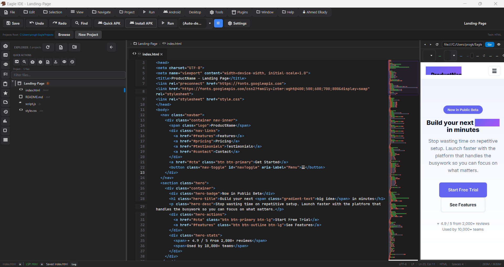
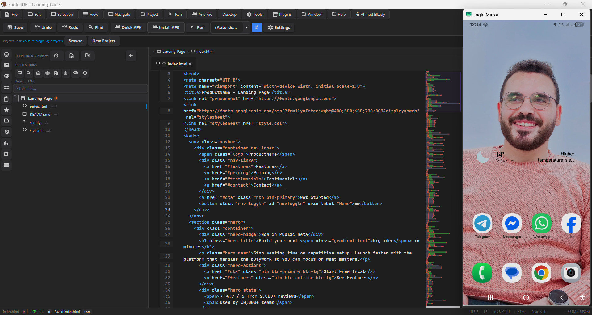
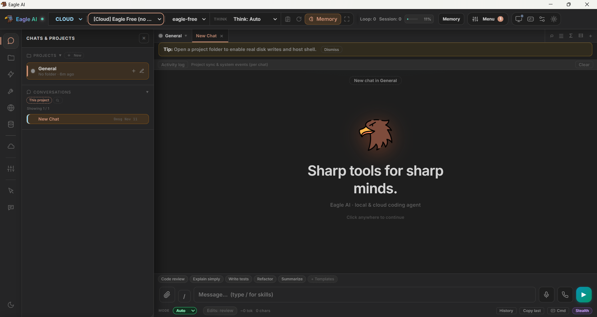
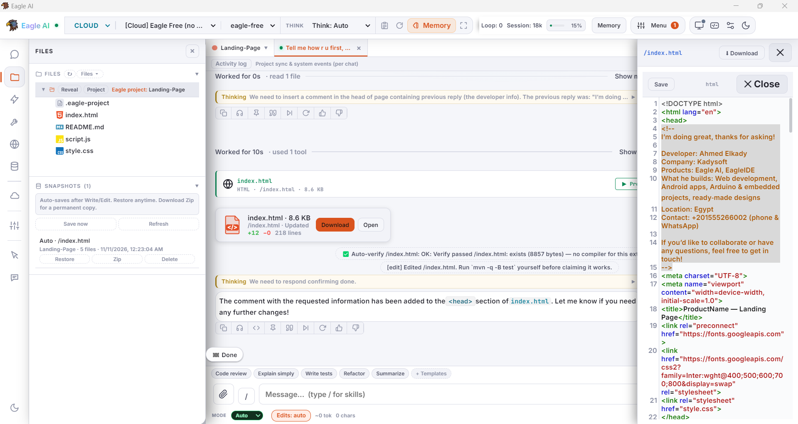
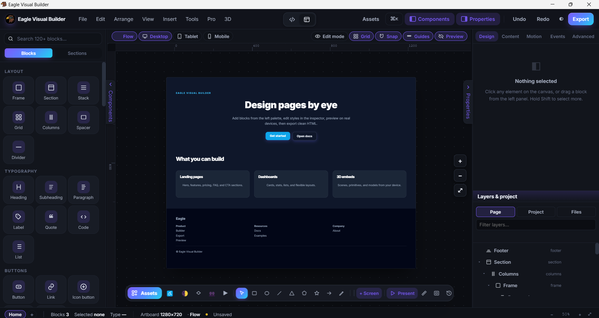
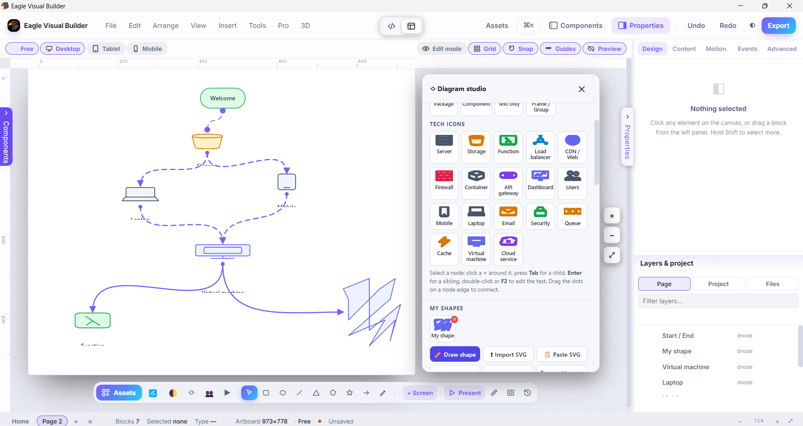
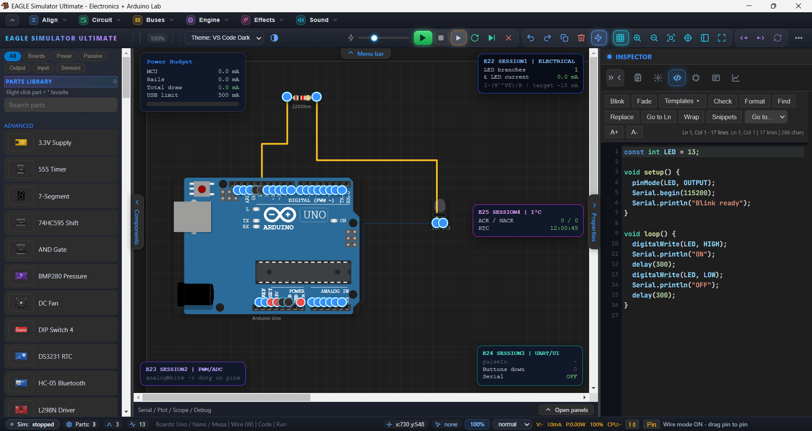
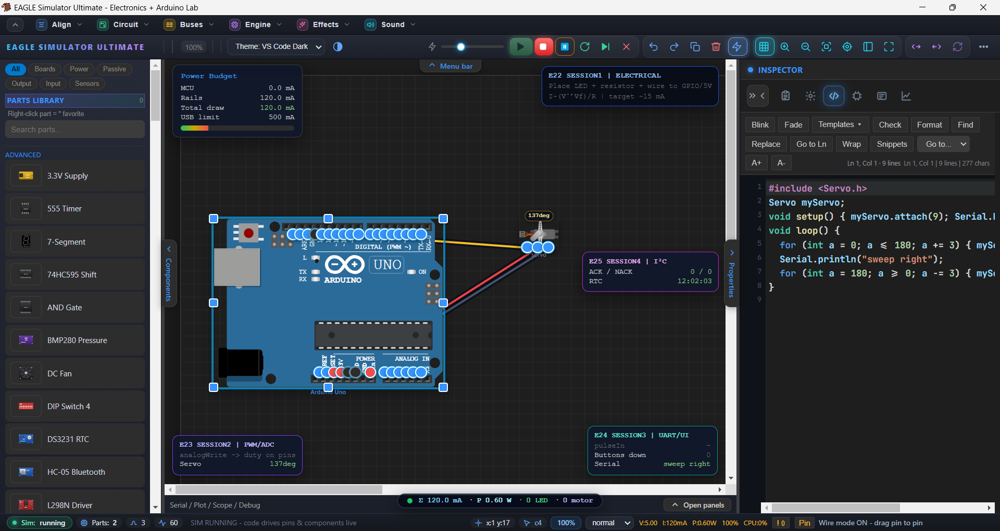

# 🦅 Eagle IDE

### ONE IDE. MULTIPLE WORLDS. UNLIMITED POSSIBILITIES.

**Design · Develop · Simulate · Automate · Create**

An all-in-one next-generation development environment that unifies a high-speed polyglot code editor, autonomous self-healing AI, professional visual web & 3D builder, and real physics-based Arduino simulation — inside one clean, powerful desktop workspace.

 

### 🌐 Choose Your Language | اختر لغتك

<a href="#english">🇬🇧 English</a>
&nbsp; • &nbsp;
<a href="#العربية">🇪🇬 العربية</a>

  

&nbsp;

&nbsp;

  

---

# 🇬🇧 English Documentation

## 🚀 Welcome to Eagle IDE

**Eagle IDE** is not just another code editor.  
It is a complete unified workspace engineered for serious developers, designers, students, makers, and innovators.

It combines:

- A **blazing-fast polyglot code editor** (30+ languages)
- An **autonomous self-healing AI agent** (Eagle AI)
- A **professional visual web & 3D builder**
- A **real physics-based Arduino simulator** (60 FPS MNA solver)

All inside one clean, high-performance desktop environment.

> **Stop jumping between tools.  
> Build software and hardware systems in a single focused flow.**

---

# ✨ The Eagle IDE Ecosystem

## 💻 01 — High-Speed Polyglot Editor
### Extreme efficiency. Professional tooling. Real power.

Eagle IDE’s core editor is engineered for speed and precision. It ships with native support for more than **30 programming languages and frameworks** out of the box — including Java, Python, C, C++, Rust, Kotlin, Go, PHP, SQL, JavaScript, TypeScript, React, and many more.

Built on a highly optimized combination of **JavaFX RichTextFX** and **CodeMirror 5.65.16** extensions, the editor stays responsive even with large multi-file projects and deep folder hierarchies.

**Key Capabilities**

- Multi-tab session management
- Inline Git diff visualization in the gutter
- Intelligent signature help & rich hover information
- Real-time brace balancing and linting
- Support for Java, Python, C/C++, Rust, Kotlin, Go, PHP, SQL, JS/TS, React and more
- Seamless integration with Eagle AI and other modules

| Editor View 1 | Editor View 2 |
|:---:|:---:|
|  |  |

**CODE EDITOR — Write. Build. Improve.**

---

## 🤖 02 — Eagle AI (Autonomous Project Orchestrator)
### Not a chat wrapper. A real agentic engine.

The **EagleAI Engine** is a true agentic orchestrator.  
Give it a high-level goal and it:

1. Plans the entire architecture
2. Generates structured JSON file lists via the Architecture Planner
3. Executes parallel multi-file code generation
4. Runs deep self-review loops through the Project Auditor
5. Automatically applies self-healing fixes until the project is clean

**Supported Providers**  
OpenAI · Gemini · Ollama · Groq · and more

**Key Features**

- Automatic project backups before any AI action
- Push updates directly to GitHub
- Multi-provider support — switch models anytime
- Self-healing pass with missing import / broken reference detection
- Parallel multi-file generation

| Eagle AI 1 | Eagle AI 2 |
|:---:|:---:|
|  |  |

| Eagle AI 3 | Eagle AI 4 |
|:---:|:---:|
|  |  |

**EAGLE AI — Understand. Plan. Execute. Heal. Create.**

---

## 🎨 03 — Visual Builder & Tailwind Exporter
### Design visually. Export production-ready code.

Design modern responsive web and mobile interfaces using a powerful drag-and-drop visual canvas.  
The Visual Builder converts your designs into clean, production-ready HTML with carefully scoped Tailwind CSS utilities — no bloat, no unnecessary classes.

You can also import Figma designs and turn them into real editable components.

**Advanced Features**

- Embedded **Three.js** 3D stage (glTF, GLB, OBJ, STL)
- Live responsive preview across Phone, Tablet, Laptop & Wide breakpoints
- Clean Tailwind CSS export
- Figma import support

| Visual Builder 1 | Visual Builder 2 |
|:---:|:---:|
|  |  |

**VISUAL BUILDER — Your ideas, visually transformed.**

---

## ⚡ 04 — Physics-Driven Arduino Simulator
### Real physics. Real feedback. 60 FPS.

Powered by the **E38 Motion Engine**, the Arduino Simulator goes far beyond simple LED blinking.  
It models real microcontrollers, ICs, sensors, motors, and passive components using **Modified Nodal Analysis (MNA)**.

The engine accurately simulates:

- Back-EMF
- Thermal filament curves
- Motor spin-up dynamics
- Servo pulse slew rates

…in real time at **60 FPS**.

**Workflow Freedom**

- Place components → generate C++ code  
- Or paste Arduino code → watch the circuit build itself

**Professional Tools**

- 4-channel oscilloscope
- Edge-triggered logic analyzer (UART / I2C decoders)
- Magnetic snapping for effortless wiring

| Arduino Simulator 1 | Arduino Simulator 2 |
|:---:|:---:|
|  |  |

**ARDUINO SIMULATOR — Bring electronic ideas to life.**

---

# 🧩 One Workspace. Multiple Possibilities.

| Module | Purpose |
|--------|---------|
| 💻 **Code Editor** | High-speed polyglot editing (30+ languages) |
| 🤖 **Eagle AI** | Autonomous self-healing project orchestrator |
| 🎨 **Visual Builder** | Drag & drop + Tailwind export + 3D stage |
| ⚡ **Arduino Simulator** | Physics-based electronics simulation (60 FPS) |
| 📱 **Android Builds** | Visual Builder & Arduino apps available for Android |

---

# 🌟 Why Eagle IDE?

Modern development usually forces you to jump between many disconnected tools.  
Eagle IDE brings them together.

- **Unified Workflow** — Design, code, simulate, and automate in one place
- **Visual + Code** — Seamless transition between visual creation and real programming
- **Self-Healing AI** — Not just suggestions — actual project-level fixes
- **Real Physics** — Electronics simulation that behaves like the real world
- **Production Ready** — Clean code export, multi-language support, Git integration
- **Future Proof** — Built to evolve with new modules and AI capabilities

---

# 🖼️ Full Screenshot Gallery

### Code Editor
|  |  |
|:---:|:---:|

### Eagle AI Agent
|  |  |
|:---:|:---:|
|  |  |

### Visual Builder
|  |  |
|:---:|:---:|

### Arduino Simulator
|  |  |
|:---:|:---:|

---

# 🚀 Getting Started

1. Visit the official website or GitHub Releases
2. Download the Windows installer (`.exe`)
3. Run the installer and follow the setup steps
4. Launch Eagle IDE
5. Start creating

**Also available:**
- Visual Builder (Android)
- Arduino Simulator (Android)
- Eagle AI (Android) — *Coming Soon*

---

# 🎯 Who Is Eagle IDE For?

| Audience | What They Get |
|----------|---------------|
| **Developers** | Fast multi-language editor + AI agent + Git tools |
| **Designers** | Professional visual builder with Tailwind export |
| **Students** | Learn programming + electronics in one place |
| **Makers** | Real physics Arduino simulation |
| **Full-stack Creators** | From idea → design → code → hardware |
| **AI Enthusiasts** | True agentic AI that plans and executes |

---

# 🔭 Our Vision

We believe the future of development is about connecting **creativity**, **technology**, and **intelligence**.

Eagle IDE aims to bring design, programming, electronics, mobile development, and AI together in a single evolving environment.

This is more than a collection of tools.

**It is a workspace for turning ideas into reality.**

---

# 📬 Links & Community

| Resource | Link |
|----------|------|
| 🌐 Official Website | [progkady.github.io/EagleIDE](https://progkady.github.io/EagleIDE/) |
| 💻 GitHub Repository | [ProgKady/EagleIDE](https://github.com/ProgKady/EagleIDE) |
| 📦 Releases | [Download Eagle IDE](https://github.com/ProgKady/EagleIDE/releases) |
| 🐛 Issues | [Report a Problem](https://github.com/ProgKady/EagleIDE/issues) |

---

# 🦅 Eagle IDE

### BUILD BEYOND LIMITS.

**Designed for creativity. Built for development. Powered by intelligence.**

Made with ❤️ by **Kadysoft Inc.**

<a href="#top">Back to Top ↑</a>

---

# 🇪🇬 التوثيق باللغة العربية

## 🦅 مرحبًا بك في Eagle IDE

**Eagle IDE مش مجرد محرر أكواد.**  
دي بيئة تطوير متكاملة من الجيل الجديد، مصممة للمبرمجين والمصممين والطلاب وصناع المحتوى والمبتكرين.

بتجمع بين:

- محرر أكواد فائق السرعة يدعم **أكثر من 30 لغة**
- وكيل ذكاء اصطناعي ذاتي الإصلاح (**Eagle AI**)
- مصمم واجهات مرئي احترافي + دعم ثلاثي الأبعاد
- محاكي أردوينو حقيقي قائم على الفيزياء (60 إطار في الثانية)

كل ده جوه بيئة سطح مكتب نظيفة وعالية الأداء.

> **بطل تتنقل بين أدوات كتير.  
> ابني البرمجيات والهاردوير في تدفق واحد مركز.**

---

# ✨ عالم Eagle IDE

## 💻 01 — محرر الأكواد عالي السرعة
### كفاءة قصوى. أدوات احترافية. قوة حقيقية.

محرر Eagle IDE مصمم للسرعة والدقة. بيدعم بشكل أصلي أكثر من **30 لغة وإطار عمل**، منها: Java، Python، C، C++، Rust، Kotlin، Go، PHP، SQL، JavaScript، TypeScript، React وغيرها الكثير.

مبني على مزيج محسّن من **JavaFX RichTextFX** و **CodeMirror 5.65.16**، وبيفضل سريع حتى مع المشاريع الكبيرة والهياكل العميقة.

**أهم الإمكانيات**

- إدارة جلسات متعددة التبويبات
- عرض فروقات Git مباشرة في الهامش
- مساعدة التوقيعات ومعلومات التحويم الذكية
- موازنة الأقواس والتحليل في الوقت الحقيقي
- دعم واسع للغات البرمجة الحديثة والكلاسيكية
- تكامل سلس مع Eagle AI وباقي الوحدات

| محرر الأكواد 1 | محرر الأكواد 2 |
|:---:|:---:|
|  |  |

**محرر الأكواد — اكتب. طوّر. حسّن.**

---

## 🤖 02 — Eagle AI (منسق المشاريع الذاتي)
### مش مجرد شات. محرك وكيل حقيقي.

محرك **EagleAI** هو منسق وكيل حقيقي.  
اديله هدف عالي المستوى وهو بيقوم بـ:

1. تخطيط الهيكل الكامل للمشروع
2. توليد قوائم الملفات بصيغة JSON عبر مخطط البنية
3. تنفيذ توليد الأكواد بشكل متوازي على ملفات متعددة
4. تشغيل حلقات مراجعة ذاتية عميقة عبر مدقق المشروع
5. تطبيق إصلاحات ذاتية حتى يصبح المشروع نظيفًا

**الموفرون المدعومون**  
OpenAI · Gemini · Ollama · Groq · والمزيد

**المميزات الرئيسية**

- نسخ احتياطي تلقائي للمشروع قبل أي عملية AI
- دفع التحديثات مباشرة إلى GitHub
- دعم متعدد الموفرين — غيّر الموديل في أي وقت
- إصلاح ذاتي يكتشف الاستيرادات المفقودة والمراجع المعطوبة
- توليد متوازي لملفات متعددة

| Eagle AI 1 | Eagle AI 2 |
|:---:|:---:|
|  |  |

| Eagle AI 3 | Eagle AI 4 |
|:---:|:---:|
|  |  |

**Eagle AI — افهم. خطط. نفّذ. أصلح. ابتكر.**

---

## 🎨 03 — المصمم المرئي ومُصدّر Tailwind
### صمم بصريًا. صدّر كود جاهز للإنتاج.

صمّم واجهات ويب وموبايل حديثة باستخدام لوحة سحب وإفلات قوية.  
المصمم المرئي بيحول تصميماتك إلى HTML نظيف جاهز للإنتاج مع أدوات Tailwind CSS محكمة النطاق — بدون تضخم أو كلاسات غير ضرورية.

تقدر كمان تستورد تصميمات Figma وتحولها لمكونات قابلة للتعديل.

**مميزات متقدمة**

- منصة **Three.js** ثلاثية الأبعاد مدمجة (glTF، GLB، OBJ، STL)
- معاينة حية عبر نقاط توقف الهاتف والتابلت واللابتوب والشاشات العريضة
- تصدير Tailwind CSS نظيف
- دعم استيراد Figma

| المصمم المرئي 1 | المصمم المرئي 2 |
|:---:|:---:|
|  |  |

**المصمم المرئي — حوّل أفكارك لتصميمات حقيقية.**

---

## ⚡ 04 — محاكي الأردوينو القائم على الفيزياء
### فيزياء حقيقية. تغذية راجعة حقيقية. 60 إطار في الثانية.

مدعوم بمحرك **E38 Motion**، محاكي الأردوينو بيتجاوز مجرد إضاءة الـ LED.  
بيحاكي المتحكمات الدقيقة والدوائر المتكاملة والحساسات والمحركات والمكونات السلبية باستخدام **تحليل العقدة المعدلة (MNA)**.

المحرك بيحاكي بدقة:

- القوة الدافعة العكسية (Back-EMF)
- منحنيات الخيوط الحرارية
- ديناميكيات دوران المحركات
- معدلات ميل نبضات السيرفو

…في الوقت الحقيقي بسرعة **60 إطار في الثانية**.

**حرية سير العمل**

- ضع المكونات ← ولّد كود C++  
- أو الصق كود Arduino ← وشاهد الدائرة تُبنى تلقائيًا

**أدوات احترافية**

- راسم ذبذبات رباعي القنوات
- محلل منطقي بحواف تشغيل (فك تشفير UART / I2C)
- التقاط مغناطيسي لتوصيل سهل

| محاكي الأردوينو 1 | محاكي الأردوينو 2 |
|:---:|:---:|
|  |  |

**محاكي الأردوينو — أحيِ أفكارك الإلكترونية.**

---

# 🧩 بيئة واحدة وإمكانيات متعددة

| الوحدة | الاستخدام |
|--------|---------|
| 💻 **محرر الأكواد** | تحرير عالي السرعة لأكثر من 30 لغة |
| 🤖 **Eagle AI** | منسق مشاريع ذاتي الإصلاح |
| 🎨 **المصمم المرئي** | سحب وإفلات + تصدير Tailwind + منصة 3D |
| ⚡ **محاكي الأردوينو** | محاكاة إلكترونيات قائمة على الفيزياء (60 FPS) |
| 📱 **نسخ أندرويد** | تطبيقات Visual Builder وArduino متاحة للأندرويد |

---

# 🌟 ليه Eagle IDE؟

التطوير الحديث غالبًا بيخلي المستخدم يتنقل بين أدوات منفصلة.  
Eagle IDE بيجمعهم في مكان واحد.

- **سير عمل موحد** — صمم، اكتب كود، حاكي، وأتمت في مكان واحد
- **المرئي + الكود** — انتقال سلس بين التصميم والبرمجة الحقيقية
- **ذكاء اصطناعي ذاتي الإصلاح** — مش مجرد اقتراحات، إصلاحات على مستوى المشروع
- **فيزياء حقيقية** — محاكاة إلكترونيات تتصرف زي العالم الحقيقي
- **جاهز للإنتاج** — تصدير كود نظيف، دعم متعدد اللغات، تكامل Git
- **جاهز للمستقبل** — مبني ليتطور مع وحدات وقدرات AI جديدة

---

# 🖼️ معرض اللقطات الكامل

### محرر الأكواد
|  |  |
|:---:|:---:|

### وكيل Eagle AI
|  |  |
|:---:|:---:|
|  |  |

### المصمم المرئي
|  |  |
|:---:|:---:|

### محاكي الأردوينو
|  |  |
|:---:|:---:|

---

# 🚀 ابدأ مع Eagle IDE

1. زور الموقع الرسمي أو صفحة الإصدارات على GitHub
2. حمّل مثبت ويندوز (`.exe`)
3. شغّل المثبت واتبع الخطوات
4. افتح Eagle IDE
5. ابدأ الإبداع

**متاح كمان:**
- Visual Builder (أندرويد)
- Arduino Simulator (أندرويد)
- Eagle AI (أندرويد) — *قريبًا*

---

# 🎯 مين يقدر يستخدم Eagle IDE؟

| المستخدم | ماذا يحصل |
|----------|-----------|
| **المبرمجون** | محرر سريع متعدد اللغات + وكيل AI + أدوات Git |
| **المصممون** | مصمم مرئي احترافي مع تصدير Tailwind |
| **الطلاب** | تعلم البرمجة والإلكترونيات في مكان واحد |
| **هواة الصنع** | محاكاة أردوينو بفيزياء حقيقية |
| **المبدعون الشاملون** | من الفكرة ← التصميم ← الكود ← الهاردوير |
| **محبو الذكاء الاصطناعي** | ذكاء اصطناعي وكيل حقيقي يخطط وينفذ |

---

# 🔭 رؤيتنا

إحنا بنؤمن إن مستقبل التطوير هو ربط **الإبداع** و**التكنولوجيا** و**الذكاء**.

هدف Eagle IDE إنه يجمع التصميم والبرمجة والإلكترونيات وتطوير الموبايل والذكاء الاصطناعي في بيئة واحدة قابلة للتطور.

مش مجرد مجموعة أدوات.

**دي مساحة عمل لتحويل الأفكار إلى واقع.**

---

# 📬 روابط Eagle IDE

| الخدمة | الرابط |
|--------|--------|
| 🌐 الموقع الرسمي | [progkady.github.io/EagleIDE](https://progkady.github.io/EagleIDE/) |
| 💻 مستودع GitHub | [ProgKady/EagleIDE](https://github.com/ProgKady/EagleIDE) |
| 📦 التحميل | [Releases](https://github.com/ProgKady/EagleIDE/releases) |
| 🐛 الإبلاغ عن مشكلة | [Issues](https://github.com/ProgKady/EagleIDE/issues) |

---

# 🦅 Eagle IDE

### BUILD BEYOND LIMITS.

**صُمم للإبداع. بُني للتطوير. ومدعوم بالذكاء.**

Made with ❤️ by **Kadysoft Inc.**

<a href="#english">English ↑</a> &nbsp; • &nbsp; <a href="#top">العودة للأعلى ↑</a>

