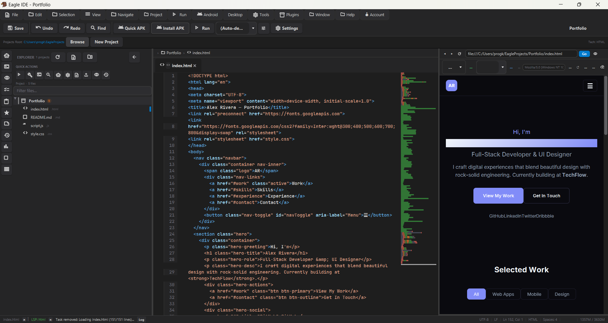
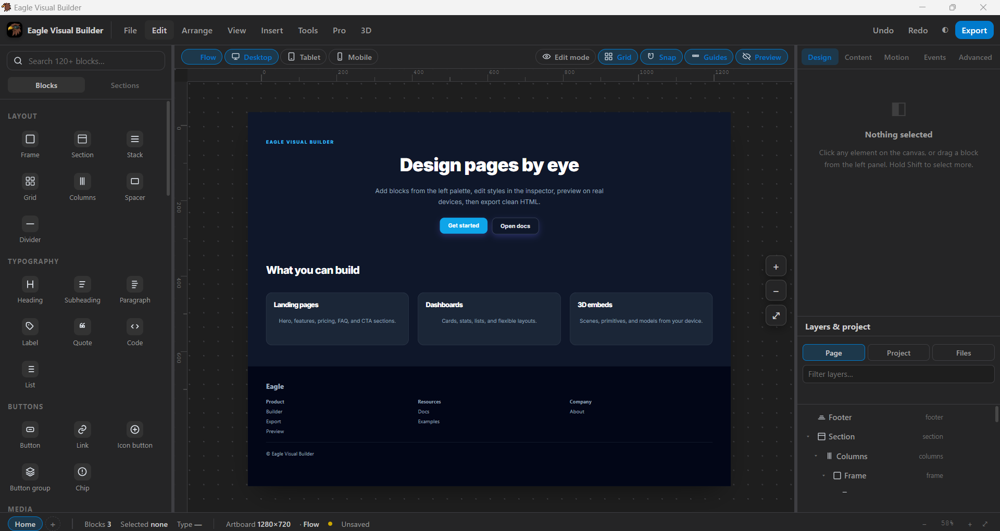
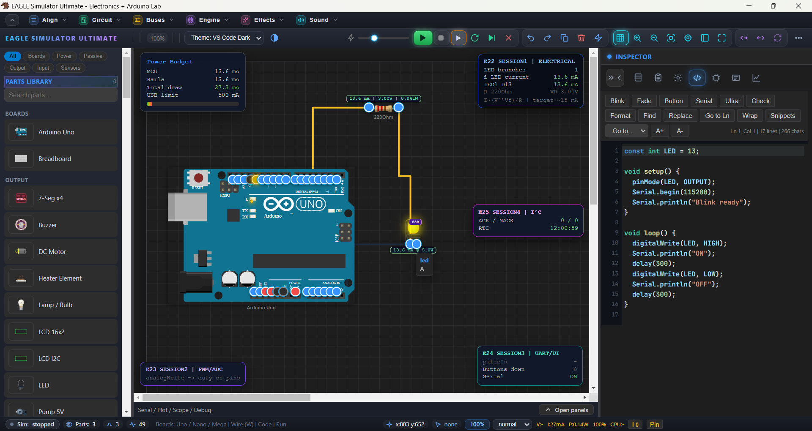

# 🦅 EagleIDE

### ONE IDE. MULTIPLE WORLDS. UNLIMITED POSSIBILITIES.

**Design · Develop · Simulate · Automate · Create**

An all-in-one development environment combining visual design, powerful code editing, Android development, Arduino simulation, and intelligent AI-powered project automation.

 

### 🌐 Choose Your Language | اختر لغتك

<a href="#english">🇬🇧 English</a>
&nbsp; • &nbsp;
<a href="#العربية">🇪🇬 العربية</a>

  

  

---

# 🇬🇧 English Documentation

## 🚀 Welcome to EagleIDE

**EagleIDE** is more than a code editor. It is an integrated desktop development environment designed to bring multiple creative and technical workflows together.

Imagine having a visual design studio, a powerful code editor, an Android development workflow, an Arduino simulator, and an intelligent AI agent — all connected within one environment.

EagleIDE is built to help developers, designers, students, and creators move from an idea to a working project without constantly switching between disconnected tools.

> **From visual ideas to real projects. From code to intelligent automation.**

---

# ✨ The EagleIDE Ecosystem

## 🎨 01 — Visual Builder
### Design Visually. Build Beautiful Interfaces.

A visual web-design workspace inspired by modern interface design tools such as Figma.

Create, arrange, customize, and refine web interfaces through a visual workflow while keeping the power of web technologies within reach.

**Key Capabilities**

- Visual interface design.
- Drag-and-drop workflow.
- Flexible element positioning and arrangement.
- Visual property editing.
- Styling and appearance customization.
- Web layout creation.
- Design-oriented project workflow.
- Connection between visual creation and web development.

Whether you're building a landing page, dashboard, portfolio, or application interface, Visual Builder helps bring your ideas to life.

**VISUAL BUILDER — Your ideas, visually transformed.**

---

## 💻 02 — Powerful Code Editor
### A Workspace Built for Developers.

A dedicated coding environment for creating, editing, and managing real development projects.

EagleIDE brings code-focused development and visual tools into one connected workspace.

**Key Capabilities**

- HTML development.
- CSS development.
- JavaScript development.
- Project and file management.
- Syntax-focused editing tools.
- Web development workflow.
- Integration with other EagleIDE modules.
- AI-assisted coding with Eagle AI.

From quick experiments to complete projects, EagleIDE gives you a place to write, organize, and improve your code.

**CODE EDITOR — Write. Build. Improve.**

---

## 📱 03 — Web to Android
### Turn Web Technologies into Mobile Experiences.

EagleIDE brings web development closer to Android application creation.

Use familiar web technologies to create application interfaces and develop mobile-oriented projects.

**Key Capabilities**

- Web-based application interfaces.
- HTML, CSS, and JavaScript workflows.
- Application project organization.
- Reuse web development knowledge.
- Connect web projects with Android development workflows.

**One creative workflow — from web to mobile.**

---

## ⚡ 04 — Arduino Simulator
### Explore Electronics. Simulate. Experiment.

An electronics simulation environment designed to help users explore Arduino projects and experiment with electronic components.

Learn by building, test your ideas, and understand how components work together.

**Key Capabilities**

- Arduino sketch development.
- Electronic component simulation.
- Component connection and pin configuration.
- Circuit experimentation.
- Interactive learning workflow.
- Test and refine project ideas.

**ARDUINO SIMULATOR — Bring electronic ideas to life.**

---

## 🤖 05 — Eagle AI
### An Intelligent Agent for Your Development Environment.

Meet **Eagle AI** — an AI-powered development assistant designed to work with projects, files, code, and available development tools.

It aims to go beyond ordinary chat by helping turn instructions into structured development tasks and practical project changes.

### 🧠 Understand

- Analyze project structures.
- Read and understand existing code.
- Explore project files and dependencies.
- Identify possible problems and improvements.

### ⚙️ Plan & Execute

- Break complex requests into smaller tasks.
- Generate and modify code.
- Create and organize project files.
- Assist with debugging and troubleshooting.
- Help improve existing implementations.
- Coordinate multi-step development workflows.

### 🖥️ Work With the Environment

Eagle AI is designed to interact with the project workspace and supported system tools.

Depending on the available integrations and permissions, it can assist with operations across files, projects, and connected development applications.

**The vision: an AI agent that doesn't just tell you what to do — it helps you get the work done.**

**EAGLE AI — Understand. Plan. Execute. Create.**

---

# 🧩 One Workspace. Multiple Possibilities.

| Module | Purpose |
|---|---|
| 🎨 Visual Builder | Visual interface and web design |
| 💻 Code Editor | Code editing and project development |
| 🌐 Web Development | HTML, CSS, and JavaScript |
| 📱 Android Workflow | Web-based Android development |
| ⚡ Arduino Simulator | Electronics and Arduino simulation |
| 🤖 Eagle AI | Intelligent development assistance |

---

# 🌟 Why EagleIDE?

Modern development often requires several separate applications for design, coding, simulation, and AI assistance.

EagleIDE aims to connect these workflows in one environment.

- **Unified Workflow:** Work across different development disciplines.
- **Visual + Code:** Combine visual creation with hands-on programming.
- **AI Integration:** Bring intelligent assistance into your projects.
- **Experimentation:** Explore electronics and simulation concepts.
- **Creative Freedom:** Move from ideas to implementation.
- **Extensible Vision:** A development environment designed to evolve.

---

# 🖼️ Screenshots

| Main Workspace | Visual Builder |
|:---:|:---:|
|  |  |

| Arduino Simulator | Eagle AI |
|:---:|:---:|
|  |  |

---

# 🚀 Getting Started

1. Visit the official EagleIDE website.
2. Open the GitHub Releases page.
3. Download the available Windows installer.
4. Run the installer and follow the setup instructions.
5. Launch EagleIDE and start creating.

---

# 🎯 Who Is EagleIDE For?

| Audience | What They Can Explore |
|---|---|
| Developers | Code editing and project development |
| Designers | Visual interface creation |
| Students | Programming and electronics learning |
| Makers | Arduino and simulation projects |
| Creators | Visual design and application building |
| AI Enthusiasts | AI-assisted development workflows |

---

# 🔭 Our Vision

We believe the future of development is about connecting creativity, technology, and intelligence.

EagleIDE aims to bring design, programming, electronics, mobile development, and AI together in a single evolving environment.

This is more than a collection of tools.

**It is a workspace for turning ideas into reality.**

---

# 📬 Links & Community

| Resource | Link |
|---|---|
| 🌐 Official Website | [EagleIDE Website](https://progkady.github.io/EagleIDE/) |
| 💻 GitHub Repository | [ProgKady/EagleIDE](https://github.com/ProgKady/EagleIDE) |
| 📦 Releases | [Download EagleIDE](https://github.com/ProgKady/EagleIDE/releases) |
| 🐛 Issues | [Report a Problem](https://github.com/ProgKady/EagleIDE/issues) |

---

# 🦅 EagleIDE

### BUILD BEYOND LIMITS.

**Designed for creativity. Built for development. Powered by intelligence.**

Made with ❤️ by **Kadysoft Ltd.**

<a href="#top">Back to Top ↑</a>

---

# 🇪🇬 التوثيق باللغة العربية

## 🦅 مرحبًا بك في EagleIDE

**EagleIDE مش مجرد محرر أكواد؛ دي بيئة تطوير متكاملة** بتجمع التصميم المرئي والبرمجة ومحاكاة الإلكترونيات وتطوير تطبيقات أندرويد والذكاء الاصطناعي في مكان واحد.

تخيل إن عندك مصمم واجهات شبيه بأدوات زي Figma، ومحرر أكواد قوي، ومحاكي أردوينو، وبيئة لتطوير تطبيقات أندرويد من الويب، ووكيل ذكاء اصطناعي يقدر يساعدك في التعامل مع المشاريع والأدوات المتاحة.

كل ده داخل بيئة واحدة.

> **من الفكرة للتصميم، ومن التصميم للكود، ومن الكود لمشروع حقيقي.**

---

# ✨ عالم EagleIDE

## 🎨 01 — Visual Builder
### صمّم واجهاتك بصريًا

مصمم واجهات مرئي مستوحى من أدوات التصميم الحديثة زي Figma.

يساعدك تبني واجهات الويب وترتب العناصر وتتحكم في شكلها وخصائصها من خلال مساحة تصميم مرئية.

**أهم الإمكانيات:**

- تصميم الواجهات بشكل مرئي.
- سحب وترتيب العناصر.
- التحكم في مواضع العناصر.
- تعديل خصائص العناصر.
- تخصيص الألوان والتنسيقات.
- بناء تخطيطات صفحات الويب.
- ربط التصميم بعملية تطوير الويب.

سواء بتصمم موقع أو لوحة تحكم أو واجهة تطبيق، Visual Builder بيساعدك تحول أفكارك لتصميم قابل للتطوير.

**Visual Builder — حوّل أفكارك لتصميمات حقيقية.**

---

## 💻 02 — محرر الأكواد
### بيئة تطوير قوية لمشاريعك

محرر مخصص لكتابة الأكواد والعمل على المشاريع وتنظيم الملفات داخل بيئة تطوير واحدة.

**أهم الإمكانيات:**

- تطوير HTML.
- تطوير CSS.
- تطوير JavaScript.
- إدارة الملفات والمشاريع.
- أدوات مخصصة لتحرير الأكواد.
- بيئة متكاملة لتطوير الويب.
- التكامل مع أدوات EagleIDE.
- مساعدة الذكاء الاصطناعي من خلال Eagle AI.

سواء بتبدأ مشروع جديد أو بتطور مشروع موجود، EagleIDE بيوفر لك مساحة عمل تجمع أدوات التطوير في مكان واحد.

**Code Editor — اكتب، طوّر، وابتكر.**

---

## 📱 03 — تطوير Android من الويب
### حوّل تقنيات الويب لتجارب موبايل

EagleIDE بيقرب المسافة بين تطوير الويب وتطوير تطبيقات أندرويد.

استخدم تقنيات الويب المألوفة في بناء واجهات وتجارب التطبيقات، ونظّم ملفات مشروعك داخل بيئة العمل.

**أهم الإمكانيات:**

- بناء واجهات باستخدام تقنيات الويب.
- استخدام HTML وCSS وJavaScript.
- تنظيم ملفات وموارد التطبيق.
- الاستفادة من خبرتك في تطوير الويب.
- ربط مشاريع الويب بسير عمل تطوير أندرويد.

**من الويب للموبايل — في بيئة واحدة.**

---

## ⚡ 04 — Arduino Simulator
### جرّب الإلكترونيات قبل تنفيذها

محاكي للأردوينو والمكونات الإلكترونية يساعدك تستكشف أفكارك وتتعلم وتختبر مشاريعك داخل بيئة محاكاة.

**أهم الإمكانيات:**

- كتابة أكواد Arduino.
- محاكاة المكونات الإلكترونية.
- تجربة التوصيلات وتحديد الأرجل.
- اختبار أفكار الدوائر الإلكترونية.
- التعلم بالتجربة والتعديل.
- تطوير أفكار المشاريع الإلكترونية.

**Arduino Simulator — جرّب أفكارك الإلكترونية.**

---

## 🤖 05 — Eagle AI
### وكيل ذكاء اصطناعي لمساعدتك في التطوير

تعرّف على **Eagle AI**، المساعد الذكي المصمم للعمل مع بيئة التطوير والمشاريع والأكواد والأدوات المتاحة.

مش مجرد شات بيرد على الأسئلة؛ الفكرة إنه يساعدك تحول طلبك لمهام تطوير فعلية.

### 🧠 الفهم والتحليل

- فهم هيكل المشاريع.
- قراءة وتحليل الأكواد.
- استكشاف الملفات والاعتماديات.
- المساعدة في اكتشاف المشاكل والتحسينات.

### ⚙️ التخطيط والتنفيذ

- تقسيم المهام الكبيرة لخطوات.
- إنشاء وتعديل الأكواد.
- إنشاء وتنظيم ملفات المشروع.
- المساعدة في اكتشاف الأخطاء وإصلاحها.
- تطوير وتحسين الأكواد الموجودة.
- تنفيذ مهام تطوير متعددة الخطوات.

### 🖥️ التعامل مع بيئة العمل

Eagle AI مصمم للتفاعل مع مساحة المشروع وأدوات النظام المدعومة.

وبحسب الأدوات والتكاملات والصلاحيات المتاحة، يقدر يساعد في تنفيذ عمليات على الملفات والمشاريع وتطبيقات التطوير المتصلة.

**الهدف: ذكاء اصطناعي مش بس يقولك تعمل إيه، لكنه يساعدك تنفذ شغلك.**

**Eagle AI — افهم، خطط، نفّذ، وابتكر.**

---

# 🧩 بيئة واحدة وإمكانيات متعددة

| الوحدة | الاستخدام |
|---|---|
| 🎨 Visual Builder | تصميم واجهات الويب بصريًا |
| 💻 Code Editor | كتابة الأكواد وتطوير المشاريع |
| 🌐 Web Development | تطوير HTML وCSS وJavaScript |
| 📱 Android Workflow | تطوير تطبيقات أندرويد من الويب |
| ⚡ Arduino Simulator | محاكاة الإلكترونيات والأردوينو |
| 🤖 Eagle AI | مساعد ذكي لتطوير المشاريع |

---

# 🌟 ليه EagleIDE؟

بدل ما تستخدم برامج منفصلة للتصميم والبرمجة والمحاكاة والذكاء الاصطناعي، EagleIDE بيحاول يجمع التجارب دي داخل بيئة واحدة.

- **تكامل الأدوات:** أكثر من مجال تطوير في مكان واحد.
- **التصميم والبرمجة:** انتقال بين العمل المرئي وكتابة الكود.
- **الذكاء الاصطناعي:** مساعد ذكي داخل سير عمل المشاريع.
- **التجربة والمحاكاة:** استكشاف الإلكترونيات والأفكار.
- **حرية الإبداع:** من الفكرة للتنفيذ.
- **التطوير المستمر:** بيئة قابلة للتوسع والتحسين.

---

# 🖼️ استكشف EagleIDE

| الواجهة الرئيسية | المصمم المرئي |
|:---:|:---:|
|  |  |

| محاكي الأردوينو | Eagle AI |
|:---:|:---:|
|  |  |

---

# 🚀 ابدأ مع EagleIDE

1. ادخل على الموقع الرسمي.
2. افتح صفحة الإصدارات على GitHub.
3. حمّل نسخة التثبيت المتاحة لنظام Windows.
4. شغّل ملف التثبيت واتبع الخطوات.
5. افتح EagleIDE وابدأ مشروعك.

---

# 🎯 مين يقدر يستخدم EagleIDE؟

| المستخدم | الاستخدام |
|---|---|
| المبرمجون | كتابة الأكواد وتطوير المشاريع |
| المصممون | بناء واجهات المستخدم |
| الطلاب | تعلم البرمجة والإلكترونيات |
| هواة الإلكترونيات | تجربة مشاريع الأردوينو |
| المبدعون | تصميم وتطوير التطبيقات |
| مهتمو الذكاء الاصطناعي | تطوير المشاريع بمساعدة AI |

---

# 🔭 رؤيتنا

إحنا بنؤمن إن مستقبل التطوير مش مجرد كتابة أكواد، لكنه ربط الإبداع بالتكنولوجيا والذكاء.

هدف EagleIDE إنه يجمع التصميم والبرمجة والإلكترونيات وتطوير تطبيقات الموبايل والذكاء الاصطناعي في بيئة واحدة قابلة للتطور.

**مش مجرد مجموعة أدوات، دي مساحة عمل لتحويل الأفكار لحقيقة.**

---

# 📬 روابط EagleIDE

| الخدمة | الرابط |
|---|---|
| 🌐 الموقع الرسمي | [EagleIDE Website](https://progkady.github.io/EagleIDE/) |
| 💻 مستودع GitHub | [ProgKady/EagleIDE](https://github.com/ProgKady/EagleIDE) |
| 📦 التحميل | [Releases](https://github.com/ProgKady/EagleIDE/releases) |
| 🐛 الإبلاغ عن مشكلة | [Issues](https://github.com/ProgKady/EagleIDE/issues) |

---

# 🦅 EagleIDE

### BUILD BEYOND LIMITS.

**صُمم للإبداع. بُني للتطوير. ومدعوم بالذكاء.**

Made with ❤️ by **Kadysoft Ltd.**

<a href="#english">English ↑</a> &nbsp; • &nbsp; <a href="#top">العودة للأعلى ↑</a>

